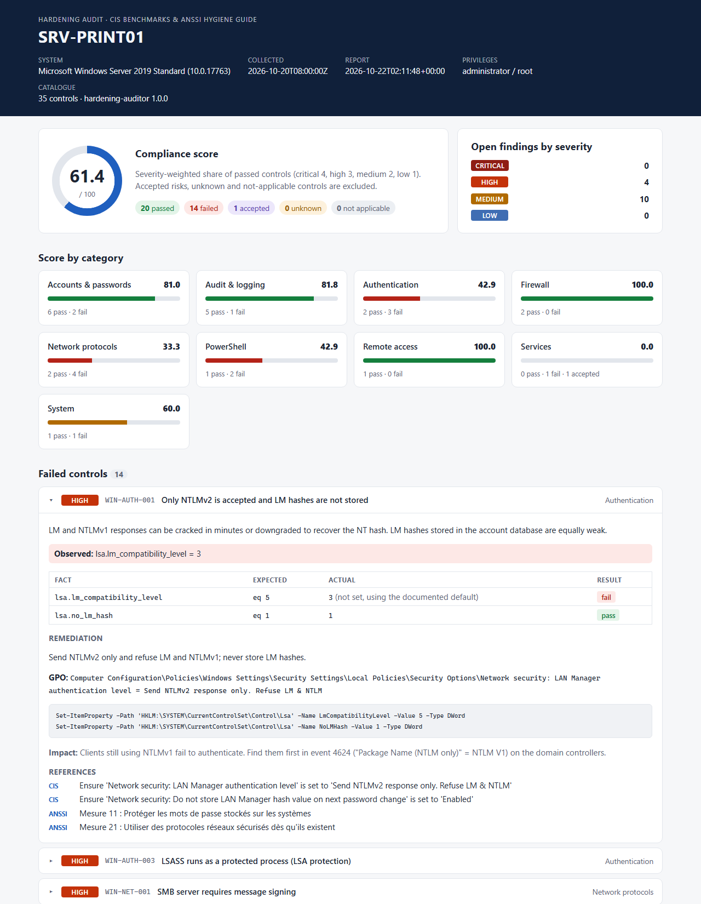
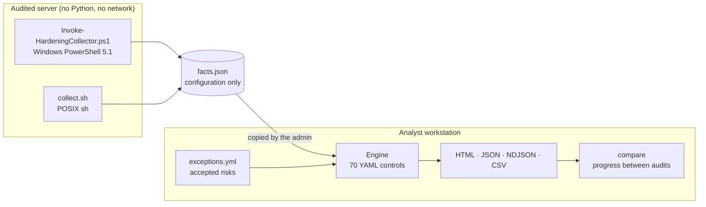

# Hardening Auditor

[](https://github.com/Barkatzineddine/hardening-auditor/actions/workflows/ci.yml)
[](https://github.com/Barkatzineddine/hardening-auditor/actions/workflows/codeql.yml)
[](https://scorecard.dev/viewer/?uri=github.com/Barkatzineddine/hardening-auditor)
[](LICENSE)

**A read-only compliance auditor for Windows and Linux servers, built on the CIS Benchmarks and
the ANSSI hygiene guide.** A dependency-free collector reads the configuration of a server and
writes one JSON file. A Python engine evaluates it against 70 controls written as YAML, and
produces an HTML report with a score per category, the failed controls sorted by severity with
their remediation, plus JSON, NDJSON and CSV exports for a SIEM or a spreadsheet.

It is built for the day-to-day work of a system and security administrator: audit a server
before it goes into production, prove the progress of a hardening campaign, and keep accepted
risks documented with an owner and an expiry date.

<picture>
  <source media="(prefers-color-scheme: dark)" srcset="docs/report-dark.png">
  
</picture>

## How it works



Collection and analysis are separate on purpose. The collector is a single script that runs on
any supported server, including isolated ones, without installing anything. The JSON file is then
analysed on an administration workstation, today or months later, with the catalogue version of
your choice.

## Safety

- **Read-only.** The collectors only read files, the registry and CIM classes, and run query
  commands (`secedit /export`, `auditpol /backup`, `sshd -T`, `systemctl is-enabled`,
  `auditctl -l`, `nft list ruleset`...). `secedit` and `auditpol` write their export to a temporary
  file that is deleted immediately. Nothing is configured, installed, started or stopped.
- **No data leaves the machine.** No network access is needed or attempted. The collector
  writes one local file; the HTML report is a single offline page whose Content Security Policy
  (`default-src 'none'`) forbids every network request.
- **Configuration facts only.** No password, hash or file content is collected: only settings,
  account names, service names and file modes. The Linux collector writes its output with mode
  `0600`. Treat the files as internal documents all the same, since they describe weaknesses.
- **Remediation is never automatic.** The report suggests a command or a GPO path and its
  impact; applying it is a change that goes through your usual change process.

> [!IMPORTANT]
> Run the collectors only on systems you are authorised to audit. On an employer's or a client's
> machines, get the approval of the system owner (and of the CISO/RSSI where one exists) first,
> even though the tool is read-only.

## Quick start

### 1. Collect, on the audited server

**Windows** (Windows Server 2016 to 2025, Windows 10/11), from an elevated PowerShell prompt:

```powershell
powershell.exe -NoProfile -ExecutionPolicy Bypass -File .\collectors\windows\Invoke-HardeningCollector.ps1 -OutputPath C:\Temp\SRV-PRINT01-facts.json
```

**Linux** (Debian, Ubuntu, RHEL, Rocky, AlmaLinux), as root:

```bash
sudo sh collectors/linux/collect.sh -o /tmp/web01-facts.json
```

Both work without administrator or root rights, but then some facts cannot be read; the report
flags the collection as partial and lists the affected controls as unknown.

### 2. Analyse, on your workstation (Python 3.12+)

```bash
git clone https://github.com/Barkatzineddine/hardening-auditor.git && cd hardening-auditor
python -m pip install --require-hashes --no-deps -r requirements.txt
python -m pip install --no-deps .
hardening-auditor audit SRV-PRINT01-facts.json --exceptions exceptions.yml --out-dir reports/
```

```text
Host     SRV-PRINT01 (Microsoft Windows Server 2019 Standard)
Score    61.4/100   pass 20  fail 14  accepted 1  unknown 0  n/a 0

Failed controls:
  HIGH     WIN-AUTH-001   Only NTLMv2 is accepted and LM hashes are not stored
  HIGH     WIN-AUTH-003   LSASS runs as a protected process (LSA protection)
  HIGH     WIN-NET-001    SMB server requires message signing
  ...
Wrote    HTML   reports/srv-print01-report.html
Wrote    JSON   reports/srv-print01-report.json
Wrote    CSV    reports/srv-print01-report.csv
```

A collector file from an offline machine is analysed the same way: copy it to the workstation
and run `audit` on it.

## Reports

| Format | Option | Use |
|---|---|---|
| HTML | `--html FILE` | Single offline page: overall and per-category scores, failed controls sorted by severity with the observed values, remediation command or GPO path and impact, accepted risks, and a filterable table of every control |
| JSON | `--json FILE` | Full results for archiving, diffing and `compare` |
| NDJSON | `--ndjson FILE` | One event per control, ready for Wazuh, Elastic or Splunk ingestion |
| CSV | `--csv FILE` | Spreadsheet follow-up of a remediation campaign (protected against formula injection) |

`--out-dir DIR` writes the HTML, JSON and CSV reports at once.

The score is the severity-weighted share of passed controls (critical 4, high 3, medium 2, low 1)
among those that passed or failed. Accepted risks, unknown and not-applicable controls are left
out: an accepted risk is neither a pass nor a fail, and an unknown control is not guessed.

### Gates for automation

| Option | Exit code 2 when |
|---|---|
| `--fail-under 80` | the score is below 80 |
| `--fail-on high` | a control of severity high or critical fails |
| `--max-unknown 0` | some controls could not be evaluated (collection not elevated, tool missing) |

### Progress between two audits

```bash
hardening-auditor compare reports/srv-print01-2026-09.json reports/srv-print01-2026-10.json --format markdown
```

`compare` accepts reports or raw collector files, and prints the score change per category, the
fixed controls, the regressions and the controls still failing, as text, Markdown (for a ticket
or a change request) or JSON. `--fail-on-regression` makes it a gate.

## Exceptions (accepted risks)

Some controls cannot be applied everywhere: a print server needs the Print Spooler, a Kubernetes
node forwards packets. Record them in a YAML file instead of ignoring the finding:

```yaml
exceptions:
  - rule: WIN-SVC-001
    hosts: ["SRV-PRINT*"]          # shell-style patterns, default: every host
    justification: Print servers need the Print Spooler. Point and Print is restricted to approved drivers by GPO.
    approved_by: RSSI
    ticket: RISK-2026-014
    expires: 2027-06-30
```

A failed control covered by a valid exception is reported as **accepted**, in its own section of
the report, with its justification, approver, ticket and expiry date. It does not count in the
score. When the date passes, the control fails again and the report says that the exception
expired. Exceptions that no longer match a failing control are reported too, so the file does not
accumulate stale entries. `hardening-auditor validate --exceptions exceptions.yml` checks the file
(syntax, rule ids, dates) in CI. See [examples/exceptions.yml](examples/exceptions.yml).

## What it checks

70 controls: 35 for Windows and 35 for Linux. Every control cites the CIS Benchmark
recommendations it implements (by title, which is stable across benchmark versions, unlike
section numbers) and the measures of the
[ANSSI Guide d'hygiène informatique](https://cyber.gouv.fr/publications/guide-dhygiene-informatique).
`hardening-auditor rules` lists them; the YAML files in
[src/hardening_auditor/rules](src/hardening_auditor/rules) hold the details.

<details>
<summary><b>Windows</b> (35): passwords and lockout, local admins and LAPS, SMB signing and SMBv1, LLMNR and NetBIOS, NTLM, WDigest, LSA protection, Credential Guard, UAC, firewall, RDP NLA, audit policy, PowerShell, services, BitLocker, updates</summary>

| ID | Control | Severity | ANSSI |
|---|---|---|---|
| `WIN-ACC-001` | Minimum password length is 14 characters or more | high | 10 |
| `WIN-ACC-002` | Password complexity is enforced and passwords are not stored reversibly | high | 10, 11 |
| `WIN-ACC-003` | Password history of 24 and a minimum password age of one day | medium | 10 |
| `WIN-ACC-004` | Account lockout stops online password guessing | high | 10 |
| `WIN-ACC-005` | Guest account is disabled | high | 8 |
| `WIN-ACC-006` | Built-in Administrator account is disabled | medium | 5, 8 |
| `WIN-ACC-007` | Local Administrators group has at most three members | medium | 5, 29 |
| `WIN-ACC-008` | LAPS manages the local administrator password | high | 11, 12 |
| `WIN-AUD-001` | Credential validation is audited (success and failure) | medium | 36 |
| `WIN-AUD-002` | Logon, special logon and account lockout events are audited | medium | 36 |
| `WIN-AUD-003` | Process creation is audited with the command line | medium | 36 |
| `WIN-AUD-004` | Account and group management changes are audited | medium | 5, 36 |
| `WIN-AUD-005` | Audit policy changes are audited and subcategories are enforced | medium | 36 |
| `WIN-AUD-006` | Security event log can hold at least 192 MB | low | 36 |
| `WIN-AUTH-001` | Only NTLMv2 is accepted and LM hashes are not stored | high | 11, 21 |
| `WIN-AUTH-002` | WDigest does not keep clear-text credentials in memory | high | 11 |
| `WIN-AUTH-003` | LSASS runs as a protected process (LSA protection) | high | 11, 14 |
| `WIN-AUTH-004` | Credential Guard is running | medium | 11, 14 |
| `WIN-AUTH-005` | UAC is enabled and filters remote local-admin tokens | high | 29 |
| `WIN-FW-001` | Windows Defender Firewall is on for every profile | high | 17 |
| `WIN-FW-002` | Firewall blocks inbound connections by default | medium | 17, 19 |
| `WIN-NET-001` | SMB server requires message signing | high | 21 |
| `WIN-NET-002` | SMB client requires message signing | medium | 21 |
| `WIN-NET-003` | SMBv1 is disabled on the server and the client | high | 21, 35 |
| `WIN-NET-004` | LLMNR multicast name resolution is disabled | high | 21 |
| `WIN-NET-005` | NetBIOS over TCP/IP is disabled on every network adapter | medium | 21 |
| `WIN-NET-006` | Anonymous enumeration of accounts and shares is blocked | medium | 9 |
| `WIN-PS-001` | PowerShell script block logging is enabled | medium | 36 |
| `WIN-PS-002` | Windows PowerShell 2.0 engine is removed | high | 14, 35 |
| `WIN-PS-003` | PowerShell runs in Constrained Language Mode | medium | 14 |
| `WIN-RDP-001` | Remote Desktop requires Network Level Authentication | high | 13, 21 |
| `WIN-SVC-001` | Print Spooler is disabled on servers | high | 14 |
| `WIN-SVC-002` | Unneeded network services are disabled | medium | 14 |
| `WIN-SYS-001` | The operating system volume is encrypted with BitLocker | medium | 31 |
| `WIN-SYS-002` | Security updates were installed in the last 45 days | high | 34 |

</details>

<details>
<summary><b>Linux</b> (35): SSH, password aging and PAM, accounts, sudo, services, firewall, auditd and logging, kernel and network sysctl, file permissions, automatic updates, time sync, mount options, SELinux/AppArmor</summary>

| ID | Control | Severity | ANSSI |
|---|---|---|---|
| `LNX-ACC-001` | Password aging is configured for new accounts | low | 10 |
| `LNX-ACC-002` | Passwords are hashed with SHA-512 or yescrypt | medium | 11 |
| `LNX-ACC-003` | Password quality requires at least 14 characters | medium | 10 |
| `LNX-ACC-004` | Accounts lock after repeated authentication failures | medium | 10 |
| `LNX-ACC-005` | PAM does not accept empty passwords | high | 10 |
| `LNX-ACC-006` | Root is the only account with UID 0 | critical | 5, 8 |
| `LNX-ACC-007` | No account has an empty password | critical | 10, 12 |
| `LNX-AUD-001` | auditd is running and auditing starts at boot | medium | 36 |
| `LNX-AUD-002` | Audit rules watch identity files and sudo configuration | medium | 5, 36 |
| `LNX-AUD-003` | System logs are kept persistently | medium | 36 |
| `LNX-FILE-001` | /etc/passwd and /etc/group are owned by root and not writable by others | medium | 9 |
| `LNX-FILE-002` | /etc/shadow and /etc/gshadow are not readable by users | high | 9, 11 |
| `LNX-FILE-003` | sshd_config is readable by root only | low | 9 |
| `LNX-FILE-004` | Bootloader configuration is readable by root only | low | 9 |
| `LNX-FW-001` | A host firewall is active | high | 17, 19 |
| `LNX-KRN-001` | Address space layout randomisation is fully enabled | medium | 14 |
| `LNX-KRN-002` | Kernel pointers, kernel logs and ptrace are restricted | medium | 14 |
| `LNX-KRN-003` | Core dumps of privileged programs and unsafe links are blocked | medium | 14 |
| `LNX-MAC-001` | A mandatory access control system is enforcing | medium | 14 |
| `LNX-MNT-001` | /tmp and /dev/shm are mounted nodev, nosuid and noexec | low | 14 |
| `LNX-NET-001` | IP forwarding is disabled | medium | 19 |
| `LNX-NET-002` | ICMP redirects and source-routed packets are refused | medium | 19 |
| `LNX-NET-003` | Spoofed and flooding packets are filtered and logged | low | 19 |
| `LNX-SSH-001` | SSH does not allow direct root login | high | 8, 29 |
| `LNX-SSH-002` | SSH password authentication is disabled | medium | 13 |
| `LNX-SSH-003` | SSH refuses empty passwords | high | 10 |
| `LNX-SSH-004` | SSH offers no weak cipher, MAC or key exchange algorithm | medium | 21 |
| `LNX-SSH-005` | SSH limits authentication attempts to four per connection | low | 10 |
| `LNX-SSH-006` | SSH disables X11 forwarding and host-based trust | medium | 21 |
| `LNX-SUDO-001` | sudo runs commands in a pseudo-terminal and keeps its own log | low | 29, 36 |
| `LNX-SUDO-002` | sudo always asks for a password | medium | 29 |
| `LNX-SVC-001` | No clear-text remote access or file transfer service is enabled | high | 21 |
| `LNX-SVC-002` | Unneeded network services are disabled | medium | 14 |
| `LNX-TIME-001` | Time is synchronised | medium | 36 |
| `LNX-UPD-001` | Security updates are installed automatically | medium | 34 |

</details>

A few design choices worth knowing:

- **Language-independent collection.** Audit policy is read by subcategory GUID from
  `auditpol /backup`, the security policy from `secedit /export`, and the elevation check uses the
  High Mandatory Level SID, so the Windows collector gives the same result on a French, English or
  German server. The suggested `auditpol` commands use GUIDs for the same reason.
- **Effective configuration.** `sshd -T` gives the SSH settings after includes and defaults; the
  firewall profiles are read from the active store (local settings merged with GPO). When
  `sshd -T` cannot run (no root, or a socket-activated sshd on Ubuntu 24.04 that has never
  started), the collector parses `sshd_config` like sshd does (`Include` expansion, first value
  wins, `Match` blocks skipped, OpenSSH defaults) and says so in its warnings.
- **Documented defaults.** When a registry value is absent, Windows applies a default. Rules state
  it (`default: 3` for `LmCompatibilityLevel`), and the report says "not set, using the documented
  default", instead of guessing or reporting a false positive.

## Add a control

Each control is one YAML file named after its id, in `src/hardening_auditor/rules/<platform>/`:

```yaml
id: LNX-SSH-005
title: SSH limits authentication attempts to four per connection
platform: linux               # windows | linux
category: SSH                 # groups the score in the report
severity: low                 # critical | high | medium | low
rationale: >
  A low MaxAuthTries slows down brute force and makes repeated failures show up quickly in the logs.
references:
  cis:
    - "Ensure sshd MaxAuthTries is configured"
  anssi: [10]                 # measure numbers of the ANSSI hygiene guide
applies_if:                   # optional: otherwise "not applicable"
  fact: ssh.installed
  op: eq
  value: true
check:
  fact: ssh.maxauthtries
  op: lte
  value: 4
remediation:
  summary: Set MaxAuthTries 4 (or lower).
  command: echo 'MaxAuthTries 4' | sudo tee /etc/ssh/sshd_config.d/10-hardening.conf
  impact: Users with many keys loaded in their agent may need IdentitiesOnly in their client configuration.
```

The check combines conditions with `all`, `any` and `not`, and evaluates them with three-valued
logic: a fact that was not collected makes the control **unknown** rather than failed, unless the
condition sets `default:` (the operating system's behaviour when the setting is absent) or
`missing: fail`.

| Operators | Meaning |
|---|---|
| `eq`, `ne` | equality (numbers numerically, strings case-insensitively, booleans from 0/1 or true/false) |
| `gt`, `gte`, `lt`, `lte` | numeric comparison |
| `in`, `not_in` | the value is (not) in a list |
| `contains`, `not_contains`, `contains_all`, `none_of`, `subset_of`, `max_items` | list facts, e.g. `ssh.ciphers none_of [3des-cbc, ...]` |
| `regex`, `not_regex` | regular expression search |
| `mode_at_most` | file permission bits, e.g. `/etc/shadow` at most `"0640"` |
| `exists`, `absent` | presence of the fact |

If the fact is new, add it to the collector, then add it to the compliant and non-compliant test
fixtures in `tests/fixtures/`: the test suite requires every control to pass on the first and fail
on the second, and checks that every fact a rule reads is produced by a collector. Organisation
specific controls can live outside the repository: `--rules DIR` loads them next to the built-in
catalogue, and `hardening-auditor validate --rules DIR` checks them.

## Quality and supply chain

| Area | What runs in CI |
|---|---|
| Real collection | The Windows collector runs with Windows PowerShell 5.1 on `windows-2022` and `windows-2025` runners, the Linux collector as root on `ubuntu-22.04` and `ubuntu-24.04`. Each run is audited with a `--max-unknown` gate (0, or 1 on Ubuntu 24.04 where sshd has never started), and the HTML, JSON, NDJSON and CSV reports are uploaded as the `sample-report-*` artifacts |
| Portability | The Linux collector also runs inside Debian 12 (dash, mawk) and Rocky Linux 9 (bash, gawk) containers without network access |
| Engine | ruff (lint and format), mypy `--strict`, 148 pytest tests with a 90 % coverage gate (99 % today), on Ubuntu and Windows |
| Scripts | ShellCheck (POSIX sh) and PSScriptAnalyzer (warnings and errors, Windows PowerShell 5.1 syntax) |
| Security | CodeQL (`security-extended`, Python and Actions), Gitleaks on the full history, pip-audit on the runtime lock, OpenSSF Scorecard |
| Supply chain | Every action pinned to a full commit SHA, least-privilege `permissions` per job, hash-locked Python dependencies compiled with a 7-day cooldown, Dependabot with the same cooldown |

## Project layout

```text
collectors/windows/   Invoke-HardeningCollector.ps1 (Windows PowerShell 5.1) and PSScriptAnalyzer settings
collectors/linux/     collect.sh (POSIX sh)
src/hardening_auditor/
  rules/              the catalogue, one YAML file per control
  conditions.py       check grammar, validation and three-valued evaluation
  catalog.py          rule loading and validation
  engine.py           evaluation, exceptions and score
  report.py           HTML, JSON, NDJSON and CSV writers
  compare.py          progress between two audits
  cli.py              audit, compare, rules, validate
tests/                pytest suite and compliant / non-compliant fixtures for both systems
examples/             exceptions file
```

## Limits

- The catalogue covers high-value controls, not a full CIS Benchmark (which has 300+
  recommendations per system). It does not replace a CIS-CAT assessment for certification.
- Domain-level settings (password policy of domain accounts, Kerberos, delegation) are seen only
  as they apply to the audited machine. Auditing Active Directory itself is out of scope.
- Container images are not audited; the Linux collector targets hosts and virtual machines.

## License

[MIT](LICENSE). CIS Benchmarks are © the Center for Internet Security; this project quotes
recommendation titles for reference and is not affiliated with or endorsed by CIS or ANSSI.
